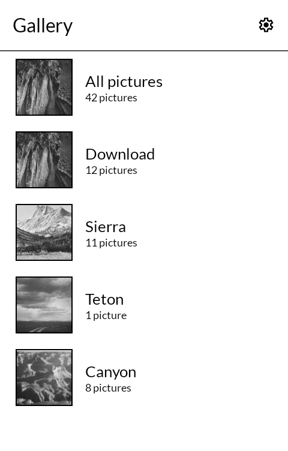
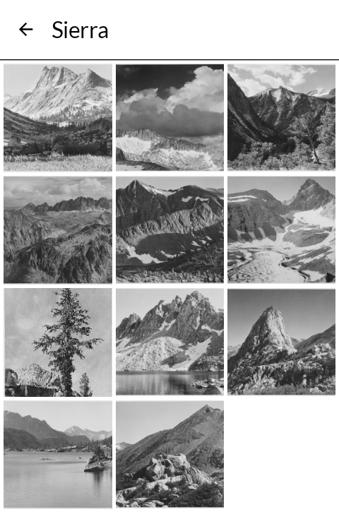
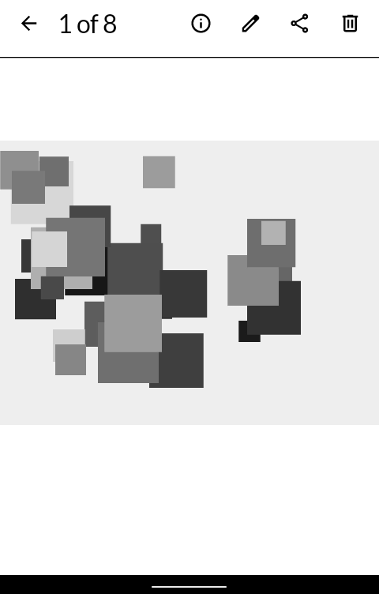
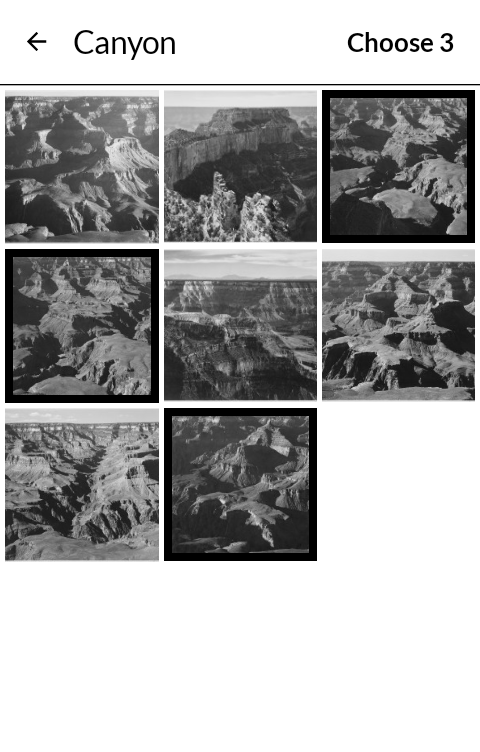

# Gallery

画廊 *garō*

The pictures and videos on the phone, by folder, one at a time — on an E Ink phone, black on white,
with nothing moving.

Built for the [Mudita Kompakt](https://mudita.com/products/kompakt/), whose 4.3" panel has
sixteen greys, a slow redraw, and is read outdoors as often as indoors.

## Screenshots

| | | | |
|---|---|---|---|
|  |  |  |  |

## What it does

- **Folders**, newest first, each with its newest picture beside it. A folder that also holds
  music or audiobooks is left out, since its pictures are covers; hold any other folder to
  hide it, and bring it back from settings.
- **All pictures**, above the folders: every picture and video on the phone in one list, newest
  first (or oldest, if that is the order chosen). Hidden folders and covers stay out of it, and
  it can be hidden itself like any folder.
- **A folder's pictures**, two, three or four across. A swipe moves a screenful and stops;
  the last row of one page is the first of the next.
- **Several deleted at once**: hold a picture in a folder to mark it with a bold edge, tap
  others to mark them too, and "Delete" in the bar takes them all, with one question from the
  phone. Back lets go of the marks.
- **One picture** on the whole panel. A tap at either side turns the page, as an e-reader
  does, and so does a swipe; a tap in the middle shows or hides the bar. Two fingers zoom,
  and one finger then moves about the enlarged picture. A double tap jumps to 100% (one picture
  pixel to one screen pixel, at full detail, centred on the tap) and a second one returns to fitted.
- **Videos** sit in their folders beside the pictures, each marked with its length. Opened,
  a video shows its first frame with a play button; it plays here, with pause, ten seconds
  back and on, and where it is. It smears, as anything moving does on this panel, but it plays.
- **Details**: when it was taken — or, when the camera recorded no date, only when it was
  saved, and it says which — its size, its folder and the camera.
- **Share** and **delete**. Deleting is asked by the phone itself, because on Android 11 and
  later a photo belongs to the app that took it.

## Share by tap

On a phone with NFC, **Share** on a picture asks how: **Share by tap**, or **Send with an app**
(the usual list of apps). Choose Share by tap, then hold the back of the other phone to the
back of this one. The other phone opens a link and the picture comes over the Wi-Fi both
phones are on.

- **How it works.** The picture is served by a small web server inside the app, on this
  phone's Wi-Fi (or hotspot) address only, never on mobile data, at a link with a random
  128-bit part that nothing else can guess. The tap is only how the link gets across: this
  phone presents itself to the other as an NFC tag holding that one link, and the other
  phone's browser opens it. Only that picture is served; any other address is a 404.
- **How long.** It stops after one finished download, after two minutes, or when you leave
  the screen. A download that breaks off does not use it up. The screen says **Sent** or
  **Stopped**, and shows the link as a large QR code under the instructions, so a phone that
  cannot tap, or whose tap does nothing, can point its camera at it and open the link in its
  browser.
- **What it needs.** NFC switched on, a Wi-Fi connection, and this phone's screen on and
  unlocked: Android answers an NFC reader only then. If NFC is off or there is no Wi-Fi, the
  screen says so, with a button to the right settings, and nothing is started.
- **What goes with the picture.** The file as the phone's library holds it. For a picture in
  the phone's own library Android takes the location out before this app reads it, as it does
  for Share; the camera, the date and the rest stay. A picture another app handed over is
  sent as that app gave it, location included. There is no setting for stripping more.
- **Nothing leaves the network.** No server, no account, no internet: see PRIVACY.md.

### Receive by tap

A Kompakt has no browser, and nothing on it that handles a tag, so it receives with
**Settings → Receive by tap**. Open it on the receiving phone, hold it back to back with the phone
that is showing Share by tap, and the picture is saved into Pictures/Received, with **Open it**
to see it at once. Both phones must be on the same Wi-Fi, and this screen must stay on.

The receiving phone reads the sender's tag itself (NFC reader mode) and takes the link from it,
but follows it only if it is `http://`, a private IPv4 address (`10.x`, `172.16`–`172.31`,
`192.168.x`, `169.254.x`), a port and a 32-digit token; anything else is ignored. It takes at most
64 MB, checks that it is a picture, and keeps nothing otherwise. The errors are plain:
**Nothing was received**, **Not on this Wi-Fi**, **The sender stopped**.

The code is in `app/src/main/kotlin/com/wanderwildwood/garo/tap/` and knows nothing of the
gallery around it, so it can be lifted into another app: `Ndef` builds the tag's record,
`TypeFourTag` answers an NFC reader's commands as an NFC Forum Type 4 tag, `OneShotServer`
serves one `Shareable` (a name, a type, a size and a stream) once, and `TapShare` ties them to
the phone's NFC and Wi-Fi. A short text or web address can instead be carried on the tag
itself (`Offer.Text`, under 800 bytes), with no server at all. `TypeFourReader` is the reading
side of the same tag, `ReceiveUrl` the check on the link and `PhotoFetch` the download.

## With the other apps

It is made to be the phone's picture app, not a room of its own.

- **Opened from Files, Email or Messaging**, a picture is shown here. One that Files or the
  camera hands over opens inside its own folder, so the pictures either side are a page-turn
  away; back returns to the app that sent it. Tap "3 of 80" at the top to go on into that
  folder, and from there the rest of the gallery.
- **The camera's "last photo"** opens here, from any camera that sends Android's review
  request — Open Camera does.
- **Attaching a picture** in Email, or anywhere that asks Android for one, offers this. Where
  the app takes several, a tap marks a picture with a bold edge and "Choose" sends them all.
- **Show in Files** opens the picture's folder in the file manager.
- **Share** reaches Wallet (札入 satsuire), which keeps a barcode in the picture as a card, and
  Translate (通訳 tsūyaku), which reads its words, when they are on the phone.
- **Settings → Opens pictures and videos** says which app opens them. Where Android still asks,
  a tap puts the question with one of the phone's own pictures: choose Gallery and *Always*.
  Where another app was chosen with *Always*, it opens that app's "Open by default" page, which
  the Kompakt's own settings leave out, to clear it.

## Immich

With an [Immich](https://immich.app) server set in settings — its address and an API key —
its albums appear below the phone's own folders, under their own heading, and open the same
way. **Timeline**, first under that heading, holds every picture on the account, in an album or
not, newest first, as Immich's own timeline does. Showing albums changes nothing on the server. Pictures are fetched at the size the screen
needs and kept on the phone, so a page turned once turns again without the network.
A swipe down at the top of the folders list, or of an album, asks Immich again, and a line
above it says "Asking Immich…" and then "Up to date".

The address has to be `https://`. A server on a Tailscale network can be given one with
`tailscale serve`. The key needs to read albums and assets and to view assets, and nothing
more. The key dialog has an eye to show what was typed, in a face where l, I and 1 differ.
When the server cannot be reached the albums last seen are still listed, and the screen
says so.

Album pictures cannot yet be shared, deleted, or chosen for another app.

**Backing up.** With a server set, **Settings → Back up** sends the pictures in the chosen
folders to the server: `DCIM`, the camera's, whichever camera app saved there, until other
folders are chosen under **Folders backed up**. Everything below a chosen folder goes, the
pictures already there as well as new ones. By default only on Wi-Fi while charging, so a
backlog goes up overnight; it can also be any Wi-Fi, or any network, and **Back up now** sends
at once. The server is asked first what it already has, by checksum, so nothing goes up twice.
The line under the switch says how many are up and when it last checked, or what it is waiting
for, the network or the charger, or that the server cannot be reached. The key needs
permission to upload assets.

## Nextcloud

Backing up can go to a [Nextcloud](https://nextcloud.com) instead of Immich: one place at a
time, chosen under **Settings → Servers and backup → Back up → Send to** when both are set up.

- **Signing in.** **Settings → Servers and backup → Nextcloud**, type the address
  (`https://cloud.example.com`), then **Sign in**: Nextcloud's own sign-in page opens in the
  browser. Sign in there and grant access; Gallery notices by itself and receives an app
  password made for this phone. Your Nextcloud password is never typed into Gallery. A phone
  without a browser can take a login name and an app password made in Nextcloud instead.
- **Where pictures go.** Into a folder of your Nextcloud files, `Photos/Kompakt` unless you name
  another, each under its own folder's path on the phone: `Photos/Kompakt/DCIM/Camera/…`.
  Missing folders are made.
- **What goes.** Everything in the chosen folders, photos and videos, the pictures already
  there as well as new ones. A file already on the server with the same name and size is not
  sent again, so a second run sends nothing, and a backup cut short carries on where it stopped.
  Nothing on the server is ever written over or deleted.
- **When.** The same choice as for Immich: on Wi-Fi while charging (the default), on any Wi-Fi,
  or on any network, and **Back up now**.
- **Signing out** deletes the app password on the server and on the phone. The pictures already
  backed up stay.

The address has to be `https://`. The app password is kept sealed by the phone's keystore.

## What it does not do

No editor, no slideshow, no wallpapers, no themes.
It reads Android's own index of pictures rather than searching the storage itself, so a
folder holding a `.nomedia` file — a folder asking not to be shown — is not shown.

## Building

```
./gradlew assembleRelease
```

A release is signed by a keystore in `signing/`, which is not in this repository. Without
it the release APK builds **unsigned** and will not install anywhere — there is no
fallback key by design.

## Credit

After [Fossify Gallery](https://github.com/FossifyOrg/Gallery), GNU General Public License
v3. It was the reference for what a gallery on Android has to handle and how it orders
things: newest first throughout, names compared the way a person reads them, the camera's
review request. The app itself is written fresh — Jetpack Compose against
[MMD](https://github.com/mudita/MMD), Mudita's E Ink component library — where Fossify is
Android views, so no screen of it carried over.

Icons are [Material Symbols](https://fonts.google.com/icons), Apache License 2.0.

The pictures in the screenshots are Ansel Adams' photographs for the National Park Service,
1941–1942, from the U.S. National Archives, in the public domain.

## Getting it, and keeping it

Download <https://github.com/wanderwildwood/garo/releases/latest/download/garo.apk>
and sideload it. That address always points at the newest release, and every release
publishes a `.sha256` beside the APK if you would rather check than trust.

For updates without doing this by hand, add this repository to
[Obtainium](https://github.com/ImranR98/Obtainium):

    https://github.com/wanderwildwood/garo

## Licence

GNU General Public License v3.0 only. See [LICENSE](LICENSE).

Copyright © wander wildwood.
